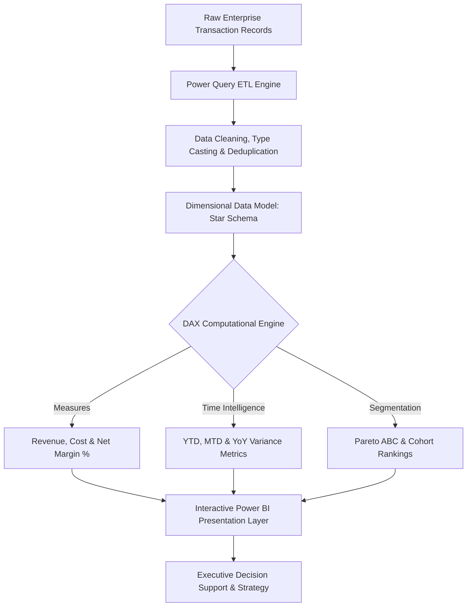

<div align="center">


[](https://powerbi.microsoft.com/)
[](https://learn.microsoft.com/en-us/dax/)
[](https://powerquery.microsoft.com/)
[](#)
[](#)

</div>

---

## 📌 Executive Summary / Overview

**Business Analytics Dashboard IV** (`BA-Experiment-4`) delivers an enterprise-grade Business Intelligence reporting and KPI monitoring solution developed with Microsoft Power BI. The project transforms multidimensional business transaction datasets into actionable executive summaries, interactive cohort slicing, and operational diagnostics.

Modern decision-makers require continuous visibility across sales volumes, geographic revenue density, profitability margins, and customer retention dynamics. This repository hosts the comprehensive `.pbix` analytics file, establishing normalized dimensional data models (Star Schema), calculated DAX aggregations, and high-contrast visual storytelling that empowers managerial decision intelligence.

---

## 📖 Interactive Table of Contents

- [Executive Summary / Overview](#-executive-summary--overview)
- [Key Features & Capabilities](#-key-features--capabilities)
- [System Architecture & BI Pipeline](#-system-architecture--bi-pipeline)
- [Tech Stack Breakdown](#-tech-stack-breakdown)
- [Key Visualizations & Analytics Metrics](#-key-visualizations--analytics-metrics)
- [Reproducible Quickstart & Setup](#-reproducible-quickstart--setup)
- [Project Directory Layout](#-project-directory-layout)
- [Author & Contributions](#-author--contributions)

---

## ✨ Key Features & Capabilities

- **Star-Schema Dimensional Modeling**: Establishes robust relationship topologies connecting central Fact transaction tables with Conformed Dimension tables (Time/Date, Product Category, Geography, and Customer Segment).
- **Calculated DAX KPI Formulations**: Custom implementations of Year-over-Year (YoY) revenue variances, rolling moving averages, margin ratios, and customer lifetime value metrics.
- **Dynamic Cross-Filtering & Slicers**: Interactive multidimensional drill-down enabling contextual cross-filtering across fiscal quarters, regional territories, and operational tiers.
- **Executive Visual Storytelling**: High-density card visuals, trend line charts with predictive forecasting ribbons, categorical bar decompositions, and geographic map distributions.
- **Power Query ETL Pipeline**: Automated data ingestion, data type validation, missing record handling, and unpivoting workflows.

---

## 🏗️ System Architecture & BI Pipeline



---

## 🛠️ Tech Stack Breakdown

| Category | Technologies & Tools |
| :--- | :--- |
| **Platform** | Microsoft Power BI Desktop (May 2024+ engine) |
| **ETL & Data Modeling** | Power Query M Language, Relational Star Schema |
| **Calculations** | DAX (Data Analysis Expressions), Time Intelligence Functions |
| **Data Formats** | `.pbix` relational bundle, CSV, Excel, Enterprise Database Feeds |
| **Visual Architecture** | Custom Cards, Decomposition Trees, Slicers, Trend Forecasts |

---

## 📊 Key Visualizations & Analytics Metrics

| Visual Component | Analytical Objective | Primary Metrics / Dimensions |
| :--- | :--- | :--- |
| **Executive KPI Strip** | Top-line managerial performance summary | Total Revenue, Gross Profit Margin, Net Transactions, Return Rate |
| **Temporal Trend Horizon** | Seasonality & cyclic growth tracking | Monthly Revenue vs. Target, 3-Month Moving Average |
| **Geographic Density Map** | Regional territory penetration | Revenue by State / Region, Delivery Fulfillment Times |
| **Product Decomposition Tree**| Root-cause margin variance diagnosis | Sales -> Category -> Subcategory -> SKU Contribution |

---

## 🚀 Reproducible Quickstart & Setup

### Prerequisites
- Microsoft Power BI Desktop (Windows 10/11) installed from the [Microsoft Store](https://aka.ms/pbidesktopstore) or official Microsoft Download Center.

### Step 1: Clone the Repository
```bash
git clone https://github.com/Jeshwanthika07/BA-Experiment-4.git
cd BA-Experiment-4
```

### Step 2: Open and Inspect the Dashboard
1. Double-click `BA Experiment 4 updated.pbix` to launch in Power BI Desktop.
2. If prompted for data credentials, click **Refresh** to load the embedded cached data model.
3. Use the page navigation tabs and interactive canvas slicers to filter KPIs dynamically.

---

## 📂 Project Directory Layout

```text
BA-Experiment-4/
│
├── BA Experiment 4 updated.pbix  # Complete Power BI dashboard, data model & visuals
└── README.md                     # Comprehensive business intelligence documentation
```

---

## 👩‍💻 Author & Contributions

Curated by **[Jeshwanthika Pothamchetty](https://github.com/Jeshwanthika07)**  
*Alliance University | Department of Computer Applications*

<div align="center">


</div>
